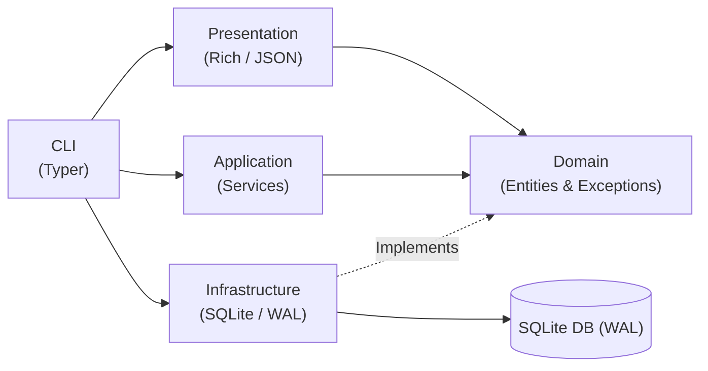

# note

Fast notes and todos that live in your terminal, saved in a single SQLite file.

Most note applications ask you to create an account, log in, or set up cloud sync. Most of the time, all you really want is to write down a quick reminder before running a deploy, then read it back twenty minutes later.

No background services, no servers, and no complicated config files. You get a single command and one local database file that you can copy, back up, move, or delete anytime.

## Features

- **Zero-Friction Terminal Keeper**: Fast, keyboard-first, and distraction-free.
- **Single SQLite File**: Zero servers, zero daemons, and zero account logins.
- **Flexible Tagging**: The `-tag` flag works before or after the note text, with or without a `#`.
- **Natural Note Entry**: Write notes directly without requiring quotes around simple phrases.
- **Multi-ID Batch Actions**: Close, reopen, or delete multiple tasks in one command (`note done 1 2 3`).
- **Piping and Stdin Support**: Pipe terminal output straight into notes (`git status --short | note add -tag git`).
- **Tags Overview**: View project tags and note counts with `note tags`.
- **Search and Detail View**: Full-text keyword search and note inspection.
- **In-Place Editing**: Edit a note body, change its tag, or update both without deleting it.
- **JSON Export**: First-class `--json` flag on list, tags, show, and search for scripts and `jq`.
- **Interchangeable Commands**: Both `note` and `notes` work out of the box.

## Installation

### From GitHub

```bash
pip install git+https://github.com/sohansai/note.git
```

### Local Development Installation

Clone the repository and install it in editable mode:

```bash
git clone https://github.com/sohansai/note.git
cd note
pip install -e .
```

Both `note` and `notes` are registered as executable commands in your shell.

## Usage

```text
note add <text> [-tag NAME]   add a note
note ls [-a] [-tag NAME]      list open notes (-a includes closed ones)
note done <id>...             close one or more notes
note open <id>...             reopen one or more closed notes
note rm <id>...               delete one or more notes
note purge                    delete every closed note
note tags                     list all tags and note counts
note search <query> [-a]      search notes by keyword
note show <id>                view full details of a note
note edit <id> [text]         edit an existing note body or tag
note version                  print version
```

### A Normal Session

```bash
$ note add "bump redis rate limit before traffic spike" -tag backend
added #1

$ note add -tag infra "verify ssl certificate renewal on edge proxy"
added #2

$ note ls
ID  AGE       TAG      NOTE
1   just now  backend  bump redis rate limit before traffic spike
2   just now  infra    verify ssl certificate renewal on edge proxy

$ note done 1
closed #1

$ note ls -a
ID  AGE       TAG      NOTE
2   just now  infra    verify ssl certificate renewal on edge proxy
1   just now  backend  ~ bump redis rate limit before traffic spike

$ note tags
TAG      OPEN  CLOSED  TOTAL
backend     0       1      1
infra       1       0      1
```

The `-tag` flag works before or after the note text because remembering an exact argument order is the kind of friction this tool avoids.

### Batch Operations

You can close, reopen, or remove several notes in one call:

```bash
# Close notes 1, 2, and 3
note done 1 2 3

# Reopen notes 1 and 2
note open 1 2

# Delete notes 1, 2, and 3
note rm 1 2 3
```

Duplicate IDs are handled safely and deduplicated automatically.

### In-Place Editing

You can update a note body, change its tag, or both:

```bash
# Update text directly without extra flags
note edit 1 "bump redis rate limit to 500 requests per second"

# Update only the tag while keeping the existing body
note edit 1 -tag cache

# Update body using the explicit flag
note edit 1 --body "check cluster memory headroom" -tag devops
```

### Keyword Search

Search for open or closed notes matching any word:

```bash
# Search open notes
note search "redis"

# Search including closed notes
note search "proxy" -a

# Filter search to a specific tag
note search "limit" -tag backend
```

Special characters such as `%` and `_` are escaped automatically.

### Stdin and Unix Pipelines

You can pipe text directly from other CLI tools:

```bash
# Save output from git into a tagged note
git status --short | note add -tag git

# Output notes as JSON for jq
note ls --json | jq '.[].body'
```

## Where Notes Live

By default, notes live in a single SQLite database file:

- **Linux and macOS**: `$XDG_DATA_HOME/note/note.db` (falling back to `~/.local/share/note/note.db`)
- **Windows**: `%LOCALAPPDATA%\note\note.db`

The database runs in SQLite WAL mode with automatic directory creation and busy retry timeouts.

### Per-Project Note Files

Set `NOTE_DB` in your environment to keep note files inside a specific project folder or repository:

```bash
export NOTE_DB=./notes.db
```

For compatibility, `note` also checks `NOTES_DB`, `TICKPOST_DB`, and `JOTTER_DB`.

## Architecture

`note` follows a clean, modular architecture:



- **Domain**: Pure Python entities (`Note`) and protocol interfaces (`NoteRepository`) with zero external dependencies.
- **Application**: Coordinates use cases, timestamp tracking, and batch workflows.
- **Infrastructure**: SQLite persistence with WAL mode, foreign keys, and automatic schema migrations.
- **Presentation**: Terminal tables via Rich and JSON formatters.
- **CLI**: Dual command entrypoints (`note` and `notes`) powered by Typer.

## License

MIT. See [LICENSE](LICENSE).
